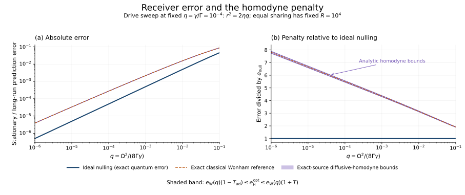

# Quantum observer redundancy

How many independent observers can accurately track a changing qubit when they share a fixed output field? For a driven dephasing source, the answer depends on the receiver. A one-bit displaced-counting receiver attains the leading quantum limit, while the best diffusive homodyne receiver retains a logarithmic error penalty even with an arbitrarily adaptive phase.

The source obeys

```math
\dot\rho=-i[\Omega X/2,\rho]+\Gamma\mathcal D[Z]\rho,
\qquad \mathcal D[Z]\rho=Z\rho Z-\rho.
```

Each observer receives a fixed fraction of the output, uses only its own past field, and predicts the outcome of a terminal projective $`Z`$ measurement. The source receives no feedback. Accuracy means each observer's long-run mean error; it does not presume a hidden classical source trajectory or simultaneous unanimous agreement.

## Principal results

For one branch of strength $`\gamma`$, write $`q=\Omega^2/(8\Gamma\gamma)`$ and $`\delta=8q`$.

| Result | Statement | Precise scope and proof |
|---|---|---|
| An explicit receiver | $`e_{\mathrm{null}}=\delta/(16+2\delta)`$ | Exact stationary error of one-bit displaced counting; [construction](science/counting.md). |
| The quantum limit | $`e_{\mathrm Q}\sim\delta/16`$ | Uniform as $`\delta\to0`$ for $`0<\gamma/\Gamma\le1/2`$; arbitrary causal quantum memory is allowed; [converse](science/quantum_limit.md). |
| The diffusive homodyne limit | $`e_{\mathrm H}\sim(q/4)\log(1/q)`$ | Received fraction and $`q`$ tend to zero; arbitrary predictable phase and classical processing; [uniform relative theorem](science/homodyne.md). |
| Detector accuracy | An exact error formula and tolerance inequality | Complex displacement error, loss and dark clicks for the specified counting policy; [imperfections](science/imperfections.md). |

At fixed source drive and total coupling, let $`R_{\mathrm Q}`$ and $`R_{\mathrm H}`$ count observers with individual error at most $`\epsilon`$. In the joint limit

```math
\epsilon\to0,\qquad s:=\frac\Omega\Gamma\to0,
\qquad s^2\log(1/\epsilon)=o(\epsilon),
```

the optimal counts satisfy

```math
R_{\mathrm Q}\sim\frac{16\epsilon}{s^2},
\qquad
R_{\mathrm H}\sim\frac{32\epsilon}{s^2\log(1/\epsilon)},
\qquad
\frac{R_{\mathrm Q}}{R_{\mathrm H}}
\sim\frac12\log\frac1\epsilon.
```

Equal fixed output fractions are optimal for this marginal error criterion. The [observer-count proof](science/observer_counts.md) explains the allocation argument, the joint limit, and finite-parameter brackets.



The figure shows a single branch at fixed received fraction $`\eta=10^{-4}`$ while the drive varies. The shaded region bounds the optimized quantum homodyne error. The dashed Wonham curve is a classical reference, not an exact finite-parameter quantum error. [Values and generator](verification/README.md) are included.

## Reading routes

| What you want to understand | Start here |
|---|---|
| The task, receiver classes and physical resource | [Model and definitions](science/model.md) |
| How a one-bit receiver works | [Displaced counting](science/counting.md) |
| Why quantum memory cannot improve the leading error | [The partial-output quantum limit](science/quantum_limit.md) |
| Why adaptive quadrature choice retains the logarithm | [Diffusive homodyne](science/homodyne.md) |
| How individual errors determine the number of observers | [Observer counts](science/observer_counts.md) |
| Which detector imperfections consume the accuracy budget | [Calibration, loss and dark counts](science/imperfections.md) |
| What is inherited and what the proofs add | [Related work](references/related-work.md) and [bibliography](references/references.bib) |

The [science entrypoint](science/README.md) connects the arguments. [llms.txt](llms.txt) maps questions to their authoritative sources.

## Reproduce the numerical checks

With Python 3.12 and the pinned dependencies:

```bash
python -m pip install -r verification/requirements.txt
python verification/verify_tracking.py
python verification/verify_quantum_limit.py
python verification/generate_comparison.py
```

The first two scripts report finite checks of independently constructed matrix models, field-overlap identities, discrimination bounds and quadratures. They return a nonzero status on failure. The third regenerates the figure and finite observer-count examples. [Verification details](verification/README.md) distinguish these checks from the analytical proofs.

## Scope

The comparison holds the total source dephasing $`\Gamma`$ fixed and supplies phase references, local oscillators and ideal local control. It does not optimize total apparatus energy or bandwidth. The homodyne theorem concerns diffusive quadrature currents, not all Gaussian receivers. The quantum converse covers received fractions at most one half; [complete collection](science/quantum_limit.md#10-complete-output-access-is-a-genuine-exception) is a distinct endpoint. Ideal counting is asymptotically optimal in the stated regime, with no claim of unrestricted finite-parameter optimality. The proofs use the exact quantum source, with an explicitly controlled classical comparison only in the homodyne argument.

## Purpose and contact

This repository serves as a record of the work and a guide for the author’s self-directed learning. For discussion or potential collaboration, please contact Ruge Lin at [gogoko699@gmail.com](mailto:gogoko699@gmail.com).
