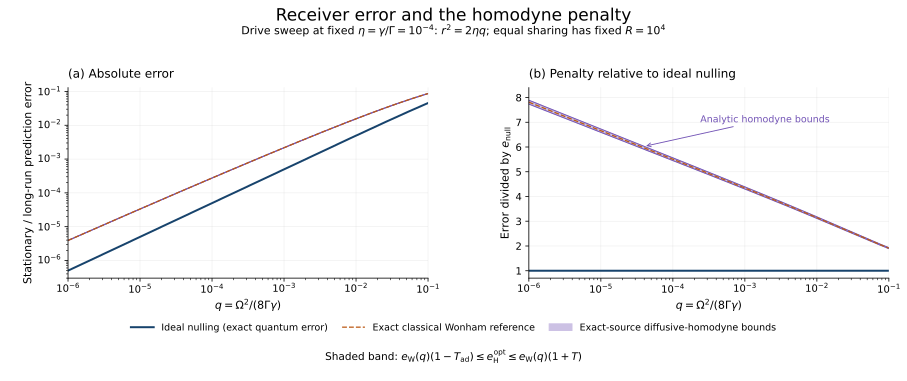

# How many observers can share the output?

The single-observer bounds determine how many independent receivers can track the same source with a given marginal accuracy. The key comparison keeps the source drive and total coupling fixed while changing the receiver class. In a joint weak-drive, small-error limit, arbitrary quantum receivers support a logarithmically larger observer count than diffusive homodyne receivers.

## 1. Fixed allocations and the weakest branch

The [model](model.md) defines $`R_{\mathrm Q}`$ and $`R_{\mathrm H}`$ using fixed output strengths $`\gamma_i`$ with $`\sum_i\gamma_i\le\Gamma`$. Every observer must have long-run mean error at most $`\epsilon`$ against the same terminal $`Z`$ test. For any allocation,

```math
\gamma_{\min}\le\frac\Gamma R.
```

Receiving a stronger branch cannot increase the optimized error. A quantum receiver can attenuate it with vacuum and discard the excess. For homodyne, a stronger measured current can be scaled and supplemented with independent Gaussian current noise to reproduce the weaker current's joint law with the source. An adaptive phase policy then uses only this degraded history. This requires no source feedback or extra measurement class.

Explicitly, for $`\gamma'\le\gamma`$ and $`\alpha=\gamma'/\gamma`$, use an independent Brownian process $`B_{\mathrm{aux}}`$ to form

```math
dY'=\sqrt\alpha\,dY+\sqrt{1-\alpha}\,dB_{\mathrm{aux}}.
```

Gaussian convolution of the measured quadrature has the same measurement probabilities as attenuated homodyne detection. Discarding the finer current gives the weaker branch's conditional source experiment. Choosing subsequent phases from $`Y'`$ preserves this equivalence sequentially.

It follows that equal sharing is optimal for this marginal criterion. To see this without assuming that an infimum is attained, take the actual receiver on the weakest branch of any feasible allocation. Under equal sharing, each observer has at least that much output and can emulate that receiver. Conversely, a lower bound at $`\gamma=\Gamma/R`$ excludes every allocation with $`R`$ observers if it exceeds the target error. Correlations among observers do not affect this argument because only their marginal errors are constrained.

Time-dependent reassignment of output and communication between observers are outside the model. They are not covered by this allocation argument.

## 2. Finite-parameter ingredients

Write $`s=\Omega/\Gamma`$. At equal sharing,

```math
\eta_R=\frac1R,
\qquad
r=\frac s2,
\qquad
q_R=\frac{s^2R}{8},
\qquad
\delta_R=s^2R.
```

The exact [counting construction](counting.md) gives

```math
R_{\mathrm Q}(\epsilon;s)
\ge R_{\mathrm{null}}(\epsilon;s)
=\left\lfloor\frac{16\epsilon}{s^2(1-2\epsilon)}\right\rfloor.
```

For $`R\ge2`$ and $`0<\delta_R<1`$, the [quantum converse](quantum_limit.md) gives the lower error bound

```math
L_{\mathrm Q}(R)
=\frac{\delta_R}{16}
\left[1-3\sqrt{\delta_R}
-\frac{20}{3}\delta_R\log^2(1/\delta_R)\right].
```

Whenever $`L_{\mathrm Q}(R)>\epsilon`$, $`R`$ observers are impossible. A negative value is uninformative and should not be interpreted as a physical error estimate.

For homodyne, the [uniform relative theorem](homodyne.md) supplies, when $`r^2+\eta_R<1`$,

```math
L_{\mathrm H}(R)
=e_{\mathrm W}(q_R)[1-T_{\mathrm{ad}}(r,\eta_R)],
\qquad
U_{\mathrm H}(R)
=e_{\mathrm W}(q_R)[1+T(r,\eta_R)].
```

Here $`T,T_{\mathrm{ad}}`$ are the explicit functions in that theorem. The exact classical reference error is

```math
e_{\mathrm W}(q)
=\frac12\left[1-\frac{e^{-q}}{q\mathcal Z(q)}\right],
\qquad
\mathcal Z(q)=\frac{e^{-q/2}}2[K_0(q/2)+K_1(q/2)].
```

If $`U_{\mathrm H}(R)\le\epsilon`$, the fixed real quadrature gives an attainable $`R`$-observer construction. If $`L_{\mathrm H}(R)>\epsilon`$, every allowed phase policy and every fixed allocation with $`R`$ observers fails. Monotonicity of the optimized error then excludes every larger count as well. This conclusion does not require either displayed bound to be monotone at all finite parameter values.

The Bessel error $`e_{\mathrm W}`$ is exact for the classical filter. It is a reference inside an explicit bracket for the quantum homodyne error, not an exact finite-parameter replacement for that error.

## 3. The observer-count theorem

Consider a family of source and tolerance parameters such that

```math
\epsilon\longrightarrow0,
\qquad s\longrightarrow0,
\qquad
s^2\log(1/\epsilon)=o(\epsilon).
```

The last condition ensures that even the homodyne observer count diverges. It makes integer rounding negligible and puts each observer in the weak-output regime.

**Theorem.** In this joint limit, for the fixed-allocation causal task,

```math
\boxed{
R_{\mathrm Q}(\epsilon;s)
\sim\frac{16\epsilon}{s^2},
\qquad
R_{\mathrm H}(\epsilon;s)
\sim\frac{32\epsilon}{s^2\log(1/\epsilon)}.
}
```

Consequently,

```math
\boxed{
\frac{R_{\mathrm Q}}{R_{\mathrm H}}
\sim\frac12\log\frac1\epsilon.
}
```

The counting receiver attains the leading quantum observer count using one classical bit per observer. The converse permits arbitrary quantum memory, so such memory cannot improve that leading coefficient in this regime.

### 3.1 Quantum count

Fix a constant $`0<a<1`$. At

```math
R_-=\left\lfloor\frac{16(1-a)\epsilon}{s^2}\right\rfloor,
```

the exact counting error is less than $`\epsilon`$ for sufficiently small parameters. At

```math
R_+=\left\lceil\frac{16(1+a)\epsilon}{s^2}\right\rceil,
```

one has $`R_+\to\infty`$ and $`\delta_{R_+}\sim16(1+a)\epsilon\to0`$. The uniform quantum lower bound therefore gives

```math
L_{\mathrm Q}(R_+)=(1+a)\epsilon[1+o(1)]>\epsilon.
```

Equal sharing and monotonicity exclude every $`R\ge R_+`$, including values for which the explicit small-$`\delta`$ bound itself would be uninformative. Taking arbitrary fixed $`a`$ and then $`a\downarrow0`$ proves the first asymptotic. This argument never extrapolates the converse beyond its stated domain.

### 3.2 Homodyne count

Put $`\Lambda=\log(1/\epsilon)`$ and consider the neighboring scales

```math
R_\pm\sim\frac{32(1\pm a)\epsilon}{s^2\Lambda}.
```

They diverge by assumption. Thus $`\eta_{R_\pm}\to0`$, $`r\to0`$, and both relative corrections $`T,T_{\mathrm{ad}}`$ vanish. Furthermore,

```math
q_{R_\pm}\sim\frac{4(1\pm a)\epsilon}{\Lambda},
\qquad
\frac{\log(1/q_{R_\pm})}{\Lambda}\longrightarrow1.
```

The classical expansion

```math
e_{\mathrm W}(q)
=\frac q4\left[\log\frac4q+1-\gamma_{\mathrm E}\right]
+O\!\left(q^2\log^2(1/q)\right)
```

therefore gives $`e_{\mathrm W}(q_{R_\pm})\sim(1\pm a)\epsilon`$. The real-quadrature upper bound makes the smaller count attainable, while the uniform lower bound excludes the larger count for every adaptive phase. Monotonicity extends the exclusion to all still larger counts. Letting $`a\downarrow0`$ proves the second asymptotic without assuming existence of an optimal phase policy.

## 4. Numerical comparison



The figure varies $`q`$ at fixed received fraction $`\eta=10^{-4}`$, with $`r^2=2\eta q`$. It compares the exact counting error with the explicit finite-parameter bracket for the optimized quantum homodyne error. The dashed classical curve is the Wonham reference. The second panel divides that bracket by the counting error. This is a single-branch error comparison across drive strengths, not a fixed-drive scan over observer counts.

The [numerical values](../figures/comparison_values.json) also give finite observer-count brackets at fixed $`s=10^{-4}`$ for three error targets. They use the exact counting formula and the homodyne upper and lower bounds above. The [generator and reproduction instructions](../verification/README.md) specify the evaluation and endpoint checks. These are floating-point evaluations of analytical bounds, not interval-arithmetic certificates.

| Error tolerance | Counting: attainable observers | Homodyne: attainable observers | Homodyne: upper bound on the optimal count |
|---|---:|---:|---:|
| $`10^{-4}`$ | 160,032 | 26,211 | 26,567 |
| $`10^{-3}`$ | 1,603,206 | 333,694 | 334,989 |
| $`10^{-2}`$ | 16,326,530 | 4,690,998 | 4,696,157 |

The counting column is the exact limit for this explicit receiver, not an exact finite-parameter quantum optimum. The homodyne columns are different sides of the analytical bracket. The inequalities are checked at the displayed attainable counts and at one more than each excluded upper count.

## 5. Physical interpretation

The resource comparison concerns the accessibility of the same emitted records. The source and its total output are unchanged. A counting receiver can use a dark hypothesis so that an ideal click resolves its present mistake. Diffusive homodyne must distinguish two overlapping current distributions while the source continues to evolve. The exact-source proofs show that this difference survives optimization over all predictable homodyne phases.

The factor $`\tfrac12\log(1/\epsilon)`$ is an asymptotic statement about a joint family of weak drives and increasingly stringent tolerances. It does not grow without limit by sending $`\epsilon\to0`$ at a fixed nonzero $`s`$. It also counts marginally accurate observers, rather than proving simultaneous unanimous agreement. The [imperfection analysis](imperfections.md) states how detector accuracy must scale to retain the ideal counting performance.
